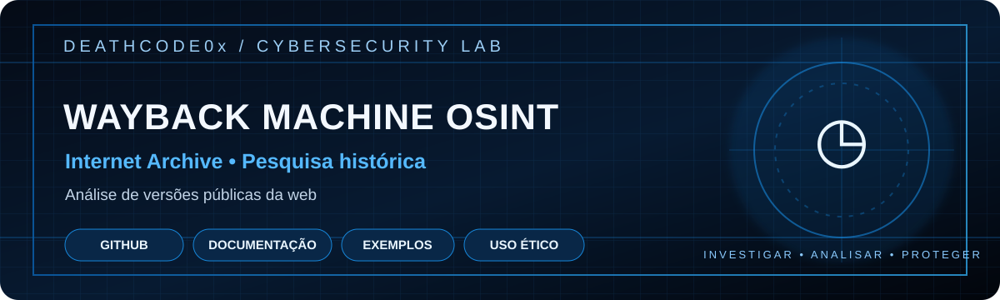

  
  
  
  

> Pesquisa de versões históricas de páginas públicas.

---

# Wayback Machine OSINT

Notas de pesquisa usando o Internet Archive Wayback Machine para estudar versões históricas de páginas públicas e apoiar investigações legítimas.

## Objetivos
- Comparar versões públicas de um site ao longo do tempo.
- Identificar mudanças em páginas institucionais.
- Preservar referências históricas e documentar evidências abertas.
- Apoiar análise de exposição em domínios próprios ou autorizados.

## Como utilizar
1. Acesse https://web.archive.org/
2. Informe uma URL pública que esteja dentro do escopo da pesquisa.
3. Escolha uma captura disponível no calendário.
4. Compare o conteúdo com a versão atual.
5. Registre URL, data da captura e contexto da análise.

## Boas práticas
- Respeite direitos autorais, privacidade e políticas de remoção do Internet Archive.
- Não tente recuperar, divulgar ou explorar credenciais e dados pessoais.
- Não interprete uma captura como prova isolada de autoria ou integridade.
- Preserve contexto, datas e limitações das evidências.

## Referência
- Internet Archive: https://archive.org/
- Wayback Machine: https://web.archive.org/

## Aviso legal
Projeto educacional de OSINT. Use somente informações públicas para finalidades legítimas e respeite a legislação aplicável.
